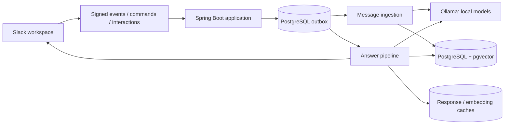

# Vedra

**An experimental Slack knowledge assistant built with Kotlin, Spring Boot and local language models.**

Vedra explores a common team problem: useful answers, decisions and project context get buried in chat, so people ask the same questions again. It turns selected channel conversations into a searchable knowledge base and brings answers back into Slack, where the discussion already happens.

> **Status: unfinished prototype / portfolio project.** Core flows and automated regression tests are implemented, but live end-to-end acceptance and answer-quality evaluation remain incomplete. This repository is shared to demonstrate the design and engineering work; it is not ready for production or sensitive workspace data.

## What is implemented

- Slack OAuth installation and workspace-to-tenant provisioning.
- Channel-linked project spaces, configuration commands and interactive Slack modals.
- Message ingestion, LLM usefulness evaluation, summaries and vector embeddings.
- Retrieval-augmented generation (RAG): reuse an accepted answer, consult a response cache, retrieve related knowledge, then generate an answer with context when available.
- A general-model fallback when suitable knowledge is unavailable, explicitly represented as a separate response source.
- Answer feedback, quality scores and promotion of knowledge into a workspace's shared space.
- PostgreSQL-backed outbox processing, embedding/response caches and Flyway migrations.
- Unit tests and MockMvc regression tests for services, controllers and Slack flows.

These are code-level capabilities, not claims of production validation. In particular, usefulness rejection is currently disabled in ingestion, question detection uses simple text heuristics, and confidence is a ranking score rather than a calibrated probability. See [project status](docs/PROJECT_STATUS.md).

## How it works



Workspace tenants contain projects; channels are linked to project knowledge. Retrieval combines semantic similarity, quality, freshness and acceptance. Feedback can influence later reuse. Models run through Ollama by default; Slack still sends workspace content to the application, which stores messages and derived knowledge locally.

## Stack

| Area | Implementation |
| --- | --- |
| Language / runtime | Kotlin 2.2.21, JDK 24 |
| Application | Spring Boot 4.0.3, Spring AI 2.0.0-M2 |
| Persistence | PostgreSQL 16, pgvector, Spring Data JPA/JDBC, Flyway |
| Models | Ollama: `llama3.2`, `nomic-embed-text` (768 dimensions) |
| Integration | Slack SDK, OAuth, Events API, slash commands, interactive messages |
| Build / tests | Gradle Wrapper 9.2.0, JUnit 5, MockK, MockMvc, ktlint |

## Run locally

Use a disposable Slack workspace and synthetic data. You need JDK 24, Docker Compose and Ollama. Follow [SETUP.md](SETUP.md) for environment variables, model downloads and Slack configuration.

```sh
cp .env.example .env
# Fill .env with local database and Slack credentials; see SETUP.md.
docker compose --env-file .env -f docker/template-docker-compose.yml up -d
ollama pull nomic-embed-text
ollama pull llama3.2
set -a
. ./.env
set +a
./gradlew bootRun --args='--spring.profiles.active=local --server.address=127.0.0.1'
```

The `.env` file must contain shell-compatible assignments. Spring Boot does not load it automatically. Never commit it.

## Verify

```sh
./gradlew check bootJar
# Explicit formatting, when needed (builds do not rewrite source files):
./gradlew ktlintFormat
# Optional local credential scan, with Gitleaks installed:
gitleaks git --redact .
```

Tests mock external services; they do not require a running database, Ollama or Slack. The `e2e` package contains controller/service regression tests, not live end-to-end acceptance. Manual scenarios are retained in [test-plan/](test-plan/).

## Repository guide

- [`src/main/kotlin/io/vedra/domain`](src/main/kotlin/io/vedra/domain): knowledge, project, tenant, feedback and caching logic.
- [`src/main/kotlin/io/vedra/infrastructure`](src/main/kotlin/io/vedra/infrastructure): persistence, Slack, Ollama, outbox and onboarding adapters.
- [`src/main/kotlin/io/vedra/api`](src/main/kotlin/io/vedra/api): HTTP chat and cache statistics endpoints.
- [`src/main/resources/db/migration`](src/main/resources/db/migration): database evolution.
- [`specs/`](specs/): original design notes, mostly in Polish; proposals may differ from the current implementation.
- [`http-client/`](http-client/): Bruno request examples; Slack requests now require valid signatures.
- [Project status and tradeoffs](docs/PROJECT_STATUS.md), [roadmap](TODO.md), [security notes](SECURITY.md), [contributing](CONTRIBUTING.md).

The current UI messages and much of the design material are in Polish. There is no web dashboard, billing system, document ingestion or Teams/Google Chat integration.

## License

No license has been selected. Public visibility alone does not grant permission to reuse or redistribute this code.
